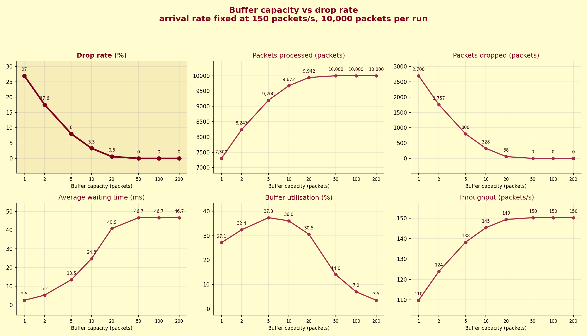
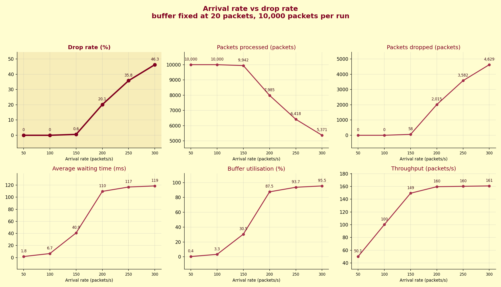

# Network-Packet-Buffer-and-Priority-Processing-Simulator

Simulating a router buffer receiving network packets based on the poisson model with exponential arrival rates and studying the effects of varying buffer capacity and arrival time using min heap (array implementation) and queue.

We evaluated the number of packets processed, processing time, packets dropped, average waiting time, buffer utilisation and the throughput.